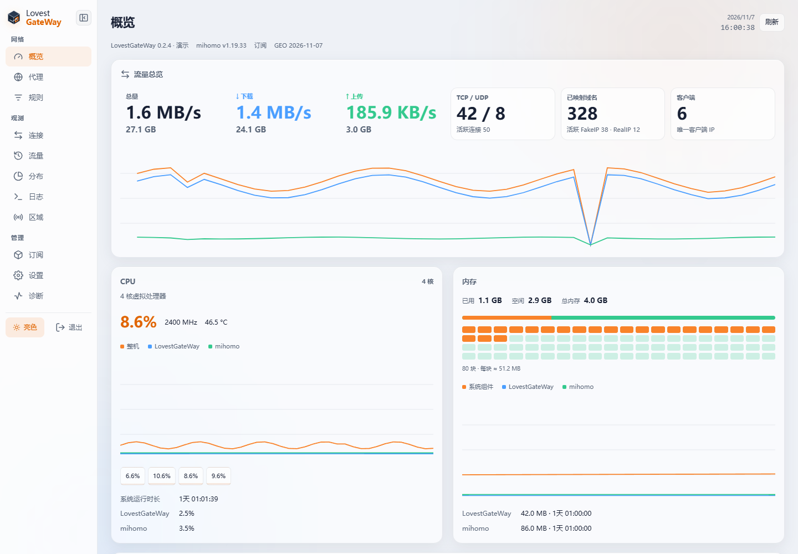
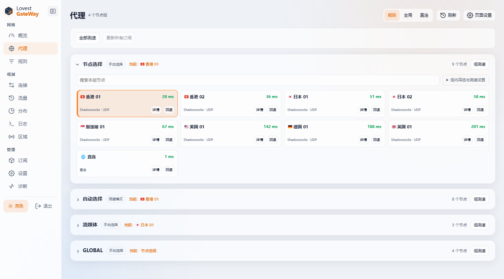
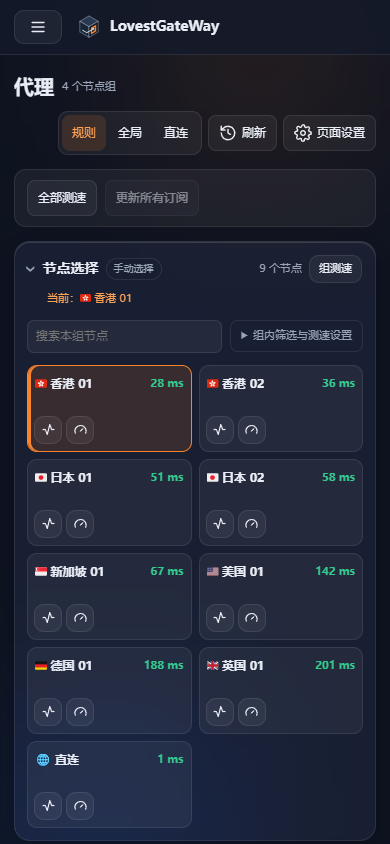

# LovestGateWay


运行在 **Debian 12/13 · amd64** 上的 Rust FakeIP 网关，使用原生 systemd 部署，通过 Web 管理订阅、节点、分流策略和运行状态。源自 [PaoPaoGateWay](https://github.com/kkkgo/PaoPaoGateWay)，保留上游来源与 GPL-3.0 许可。

- **Web 日常管理**：订阅与规则编辑、节点切换与测速、配置预览和应用。
- **运行观测**：连接、流量、分布、日志、区域检测及诊断恢复。
- **安装与升级**：中文安装向导、Web 网关升级、Mihomo 独立更新、备份与失败恢复。
- **桌面与手机**：可收起侧栏、亮暗主题、紧凑工具栏和大列表分批展示。

## 界面预览

以下使用当前源码和虚构演示数据生成，不包含真实订阅、节点地址或凭据。



<details>
<summary>查看代理页面与暗色手机界面</summary>





</details>

## 一键安装

在目标 Debian 机器执行：

```sh
curl -fsSL https://raw.githubusercontent.com/Lovest20018/LovestGateWay/main/install.sh | sudo sh
```

脚本下载最新正式版，校验安装包后进入中文向导，安装完成会显示 Web 地址。没有 curl 时，先运行 `sudo apt-get update && sudo apt-get install -y curl ca-certificates`。

1. 打开安装器显示的 Web 地址，使用设置的管理密码登录。
2. 在 **设置 → 维护与 API** 安装 Mihomo；CPU 型号通常保持“自动”。
3. 在 **订阅** 添加配置，按需设置节点组和规则。
4. 按需开启 UDP、IPv6 和统计，再配置主路由的 DNS 与路由，并从实际终端验证网络。

新安装默认直连，可选功能按需启用。安装器不修改宿主 IP 或主路由。离线安装及常见问题见[安装与升级](docs/debian-deployment.md)。

## 升级

在 **设置 → 维护与 API → LovestGateWay 更新** 检查并确认升级，或重新运行上面的一键命令。升级保留配置、密码、订阅和服务启动设置；重启期间会短暂断连，重新登录后继续查看原任务，完成后刷新页面。

网关程序与 Mihomo 核心分别更新。旧版没有 Web 更新入口时，先用一键命令升级一次。安装包、源码和校验文件见 [Releases](https://github.com/Lovest20018/LovestGateWay/releases/latest)；一键命令始终下载正式版，源码主线的交付与验收边界见[项目状态](docs/optimization-roadmap.md)。

## 文档

| 想做什么 | 入口 |
| --- | --- |
| 安装、升级、排查常见问题 | [安装指南](docs/debian-deployment.md) |
| 使用面板、订阅和分流策略 | [Web 使用说明](docs/debian-web-settings.md) |
| 在终端备份、恢复和管理 | [命令行参考](docs/debian-management.md) |
| 开发、API、上游同步与验收 | [文档导航](docs/README.md) |

日常使用无需开启对外观测 API。终端管理可运行 `sudo ppgw-admin`。

本项目独立发布 Debian 安装包；每周检查上游更新，经评审、移植和验收后选择性跟进。[上游关系](docs/upstream-maintenance.md) · [GPL-3.0](LICENSE)
