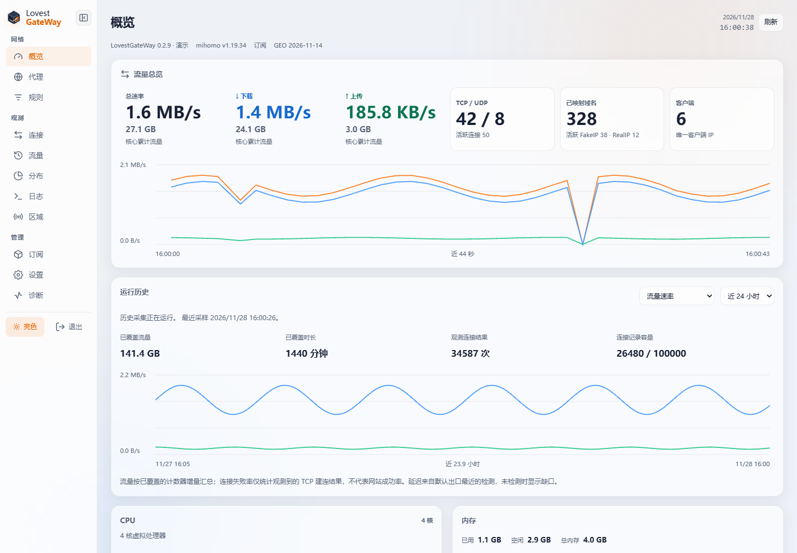
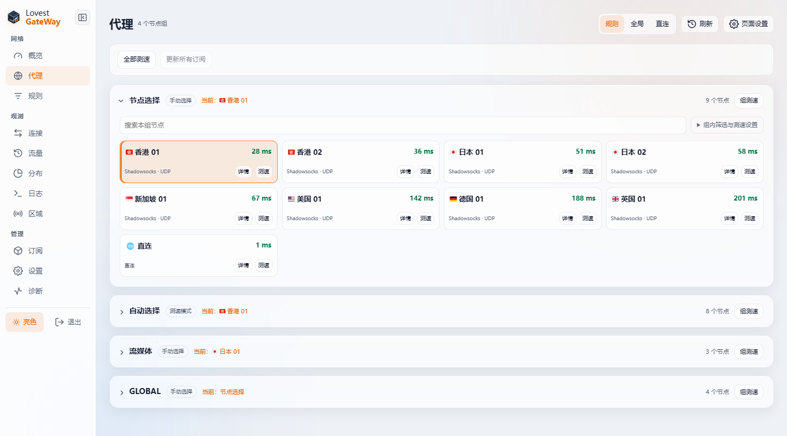
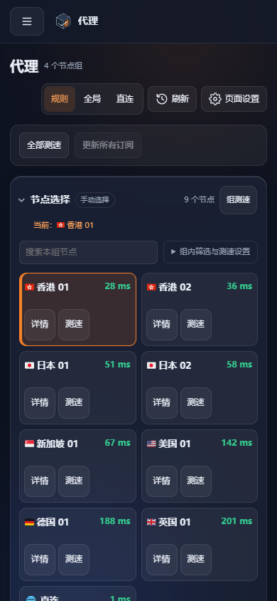

# LovestGateWay


[](https://github.com/Lovest20018/LovestGateWay/releases/latest)
[](https://github.com/Lovest20018/LovestGateWay/actions/workflows/debian.yml)
[](LICENSE)

运行在 **Debian 12/13 · amd64 · systemd** 上的 Rust FakeIP 网关，通过 Web 管理订阅、节点、分流策略和运行状态。支持原生 Debian 部署，源自 [PaoPaoGateWay](https://github.com/kkkgo/PaoPaoGateWay)，保留上游来源与 GPL-3.0 许可。

[安装](#一键安装) · [升级](#升级) · [使用文档](docs/README.md) · [更新记录](CHANGELOG.md) · [问题反馈](https://github.com/Lovest20018/LovestGateWay/issues)

## 能做什么

| 功能 | 使用方式 |
| --- | --- |
| 网关转发 | FakeIP DNS、透明 TCP/UDP；保留直连、SOCKS5、OpenVPN、YAML 和订阅五种出站模式 |
| 订阅与分流 | 编辑完整 Clash/Mihomo 配置或原生 PPsub，管理节点组、规则和更新计划 |
| 节点管理 | 手动切换、测速和提供商更新；原生 PPsub 可按组开启故障转移 |
| 运行观测 | 实时连接、流量、分布、日志；可选保存历史流量、资源使用、建连结果和出口检测延迟 |
| 局域网代理 | HTTP / SOCKS5 共用 `1080` 端口，独立填写代理用户名、密码和允许访问范围 |
| 维护与恢复 | 配置预览、后台任务、网关升级、Mihomo 独立更新、备份及失败恢复 |

桌面与手机使用同一套面板，支持侧栏收起、亮暗主题和大列表分批展示。日常使用无需开启对外观测 API。

## v0.2.6

- 代理账号拆分为用户名和密码，保存后回显用户名，并显示固定端口及客户端连接说明。
- 概览增加近 1 小时 / 24 小时运行历史；采样缺口和核心重启保留为缺口，避免产生虚假流量。
- 减少控制循环重复日志和等价订阅引起的重启，增加真实 PPsub CLI 的合成故障切换验证。

升级保留已有组模式，**不会自动开启故障转移或历史采集**。详细说明见 [v0.2.6 发布说明](docs/releases/0.2.6.md)。

## 界面预览

以下截图由当前源码和虚构演示数据生成，不包含真实订阅、节点地址或凭据。



<details>
<summary>查看代理页面与暗色手机界面</summary>





</details>

## 一键安装

在目标 Debian 机器执行：

```sh
curl -fsSL https://raw.githubusercontent.com/Lovest20018/LovestGateWay/main/install.sh | sudo sh
```

脚本下载最新正式版，校验安装包后进入中文向导，安装完成会显示 Web 地址。没有 curl 时，先运行 `sudo apt-get update && sudo apt-get install -y curl ca-certificates`。

1. 打开安装器显示的 Web 地址，使用设置的管理密码登录。
2. 在 **设置 → 维护与 API** 安装 Mihomo；CPU 型号通常保持“自动”。
3. 在 **订阅** 添加配置，按需设置节点组和规则。
4. 配置主路由的 DNS 与路由，按需开启 UDP、IPv6 和统计，再从实际终端验证网络。

新安装默认直连，可选功能按需启用。安装器不修改宿主 IP、默认路由或主路由。离线安装、端口占用与恢复方法见[安装与升级](docs/debian-deployment.md)。

## 常用设置

| 想做什么 | 入口与说明 |
| --- | --- |
| 使用 HTTP / SOCKS5 代理 | **设置 → 访问与统计 → 局域网代理**：开启后设置用户名、密码和来源范围，客户端连接网关 LAN IP 的 `1080` 端口 |
| 节点失败后自动切换 | **订阅 → 节点组 → 故障转移**：原生 PPsub 按组开启；健康时保留选择，全部失败时保留当前选择 |
| 查看过去 1 小时 / 24 小时指标 | **设置 → 维护与 API**：开启观测 API 和 API 历史采集，然后在**概览 → 运行历史**查看；只供本机使用时 API 保留 `127.0.0.1` 监听 |
| 更换管理密码或监听地址 | **设置**：预览影响后确认应用；密码变更或核心重启后重新登录继续查询原任务 |

历史从开启后积累，不补造过去数据。连接失败率仅代表已观测 TCP 建连结果，不等同于网站成功率；延迟来自默认出口已有的近期检测，采集不会主动测速。[完整 Web 使用说明](docs/debian-web-settings.md)

## 升级

在 **设置 → 维护与 API → LovestGateWay 更新** 检查并确认升级，或重新运行上面的一键命令。升级保留配置、密码、订阅和服务启动设置；重启期间会短暂断连，重新登录后继续查看原任务，完成后刷新页面。

网关程序与 Mihomo 核心分别更新。旧版没有 Web 更新入口时，先用一键命令升级一次。正式附件包含 Debian amd64 安装包、对应源码、SHA256 文件、安装入口和发布清单，见 [Releases](https://github.com/Lovest20018/LovestGateWay/releases/latest)。发布新版本不会自动升级已有服务器。

## 文档与开发

| 需求 | 入口 |
| --- | --- |
| 安装、升级与常见问题 | [安装指南](docs/debian-deployment.md) |
| 面板、订阅、策略与历史指标 | [Web 使用说明](docs/debian-web-settings.md) |
| 终端备份、恢复和管理 | [命令行参考](docs/debian-management.md) |
| 所有文档与 API | [文档导航](docs/README.md) |
| 开发环境、目录与反馈规范 | [参与开发](CONTRIBUTING.md) |
| 实现状态与验收边界 | [项目状态](docs/optimization-roadmap.md) |

终端管理可运行 `sudo ppgw-admin`。源码主线持续开发，部署应使用正式 Release；目前正式包仅提供 Debian amd64，根目录保留的 ISO / ARM64 / Docker 构建脚本属于上游兼容资料，不代表本项目发布这些产物。

本项目每周检查上游更新，经评审、移植和验收后选择性跟进。[上游关系](docs/upstream-maintenance.md) · [GPL-3.0](LICENSE)
